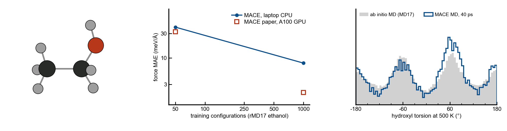
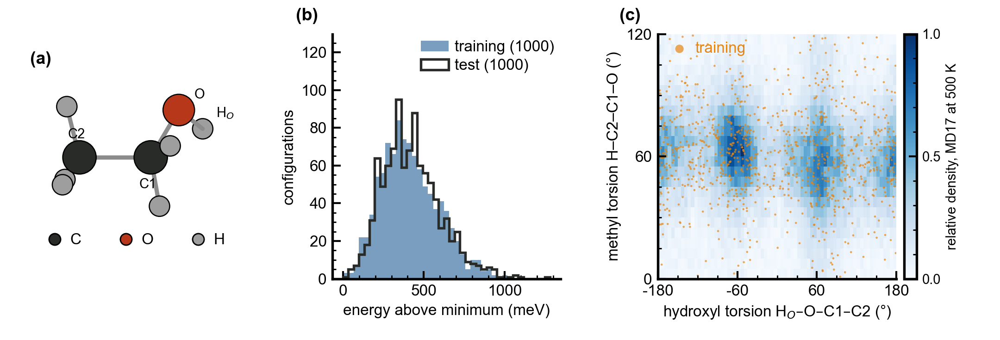
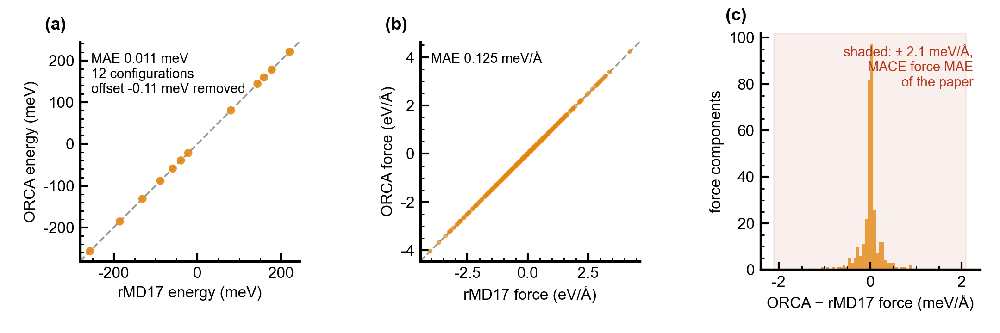
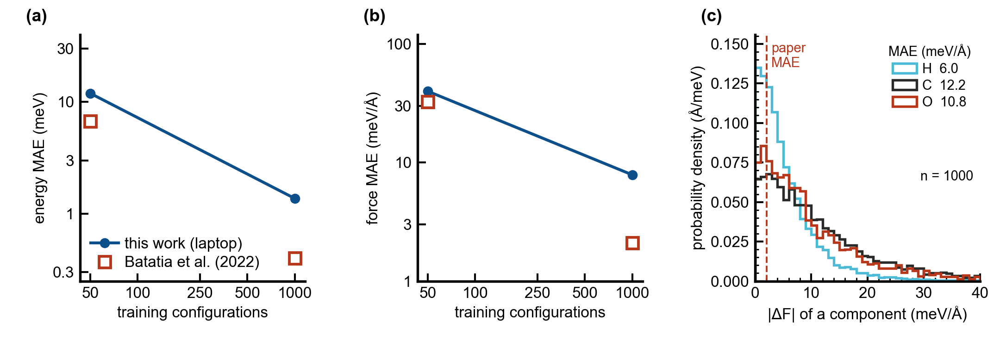
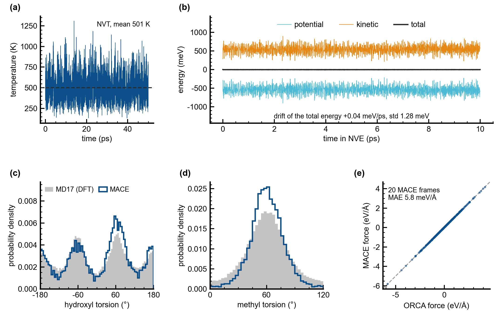
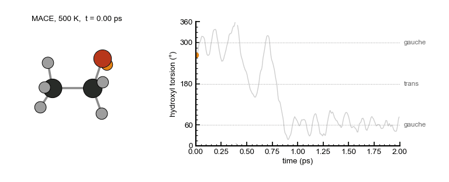

<p align="center">
  <picture>
    <source media="(prefers-color-scheme: dark)" srcset="docs/images/banner_dark.png">
    
  </picture>
</p>

<h1 align="center">mace-rmd17-ethanol</h1>

<p align="center">
  <b>Reproducing the MACE result for ethanol on the revised MD17 dataset on a laptop, with ORCA for the reference data</b>
</p>

<p align="center">
  
  
  
  
</p>

<p align="center">
  <a href="#results">Results</a> &nbsp;·&nbsp;
  <a href="#what-the-study-does">What the study does</a> &nbsp;·&nbsp;
  <a href="#installation">Installation</a> &nbsp;·&nbsp;
  <a href="#running-the-study">Running the study</a> &nbsp;·&nbsp;
  <a href="#learning-notebook">Learning notebook</a> &nbsp;·&nbsp;
  <a href="#differences-from-the-paper">Differences from the paper</a> &nbsp;·&nbsp;
  <a href="#references">References</a>
</p>

<br>

MACE is a machine-learned interatomic potential built from equivariant message passing with many-body
messages [1]. Its paper reports, among other benchmarks, the errors on the revised MD17 dataset (rMD17) [2],
energies and forces of ten small organic molecules recomputed with ORCA at the PBE/def2-SVP level. This
repository repeats the ethanol entry of that table on a laptop CPU, from the download of the data to molecular
dynamics with the trained potential, and uses ORCA to check the reference data and the configurations that
the potential generates in its own dynamics. A notebook explains every step.

## Results

Errors on the 1000 test configurations of rMD17 split 1:

| Training configurations | | Energy MAE (meV) | Force MAE (meV/Å) |
| --- | --- | --- | --- |
| 50 | MACE paper [1] | 6.7 | 32.6 |
| 50 | this study | 12.0 | 40.0 |
| 1000 | MACE paper [1] | 0.4 | 2.1 |
| 1000 | this study | 1.4 | 7.9 |

- **The reference data can be reproduced.** ORCA 5 recomputes 12 rMD17 test configurations with a force MAE of
  0.12 meV/Å and a relative energy MAE of 0.01 meV, about 17 times below the smallest force error of the paper
  (Figure 2).
- **With 50 configurations the laptop model is close to the paper:** forces 1.2 and energies 1.8 times the
  published errors. With few data, the data limit the error more than the size of the model.
- **With 1000 configurations it is about four times above the paper.** The model has 64 instead of 256 channels
  and messages up to L = 1 instead of L = 3, and it trained for 250 epochs (3.4 h on a CPU). From 50 to 1000
  configurations the force error falls 5-fold here and 16-fold in the paper (Figure 3).
- **The potential runs stable molecular dynamics.** In 50 ps at 500 K (mean 501 K) and 10 ps without thermostat,
  the total energy fluctuates by 1.3 meV and drifts by +0.04 meV/ps. Twenty frames of the MACE trajectory,
  recomputed with ORCA, give a force MAE of 5.8 meV/Å and a relative energy MAE of 1.0 meV, no worse than the test
  set: the dynamics stays where the model was trained (Figure 4).
- **The torsions follow the ab initio trajectory.** MACE spends 27 % of the time in the trans conformer of the
  hydroxyl group against 29 % in MD17. The methyl distribution of MACE is narrower; the MD17 trajectory was run at
  a different level of theory (PBE+vdW-TS) than the rMD17 labels the model learned, and the notebook discusses
  this.

<p align="center">
  
</p>

**Figure 1. The data.** (a) Ethanol, with the atoms of the hydroxyl (H<sub>O</sub>–O–C1–C2) and methyl
(H–C2–C1–O) torsions. (b) Energies of the training and test configurations of split 1, relative to the lowest
energy of the two sets. (c) The two torsions over the 100 000 configurations of the 500 K ab initio trajectory,
with the 1000 training configurations as points.

<p align="center">
  
</p>

**Figure 2. ORCA reproduces the rMD17 labels.** (a) Energies and (b) force components of 12 test configurations,
recomputed with ORCA 5 at PBE/def2-SVP, against the published values. (c) Differences of the force components;
the shaded band is the force MAE of MACE in the paper.

<p align="center">
  
</p>

**Figure 3. Accuracy on the test set.** (a) Energy and (b) force MAE against the number of training
configurations, for this study and the paper. (c) Distribution of the errors of the force components of the model
trained on 1000 configurations, by element, with the force MAE of the paper as a dashed line.

<p align="center">
  
</p>

**Figure 4. Molecular dynamics with MACE.** (a) Temperature during 50 ps with a Langevin thermostat at 500 K.
(b) Potential, kinetic and total energy in the following 10 ps without thermostat. (c) Hydroxyl and (d) methyl
torsion over the last 40 ps of the NVT run, against the MD17 trajectory. (e) Forces of 20 frames of the MACE
trajectory recomputed with ORCA.

<p align="center">
  
</p>

**Animation.** 2 ps of the MACE run at 500 K, drawn in the frame of the C-C-O atoms, with the hydroxyl hydrogen in
orange. The molecule moves from one gauche minimum of the hydroxyl torsion (300°) across trans (180°) to the other
(60°).

## What the study does

<table>
<tr>
<th width="33%">Reference data</th>
<th width="33%">Potential</th>
<th width="34%">Checks</th>
</tr>
<tr>
<td valign="top">

- Downloads rMD17 and checks its md5 sum
- Takes the training and test configurations of split 1
- Recomputes test configurations with ORCA 5 at the rMD17 level and compares with the published labels
- Keeps every ORCA input and output

</td>
<td valign="top">

- Trains MACE with the settings of the paper on 50 and 1000 configurations
- Runs on a laptop CPU in about four hours
- Writes the trained models, ready for ASE

</td>
<td valign="top">

- Errors on the 1000 test configurations, compared with the paper
- 50 ps of molecular dynamics at 500 K and 10 ps without thermostat
- Torsion distributions compared with the ab initio trajectory
- MACE frames recomputed with ORCA

</td>
</tr>
</table>


## Installation

```bash
git clone https://github.com/kourosh-h/mace-rmd17-ethanol.git
cd mace-rmd17-ethanol
conda env create -f environment.yml
conda activate mace-rmd17
```

ORCA is free for academic use and is installed separately ([faccts.de/orca](https://www.faccts.de/orca/)). The
scripts call it through the environment variable `ORCA_EXE`, which must hold the full path of the executable:

```bash
export ORCA_EXE=$HOME/orca_5_0_4/orca
```

The ORCA calculations run serially, one per CPU core, so no MPI installation is needed.


## Running the study

```bash
bash run_all.sh
```

runs all steps in order. Each step can also be run alone; each skips work that is already done.

| Step | Script | What it does | Time on a laptop |
| --- | --- | --- | --- |
| 0 | `scripts/download_rmd17.sh` | downloads rMD17 (1.0 GB), checks the md5 sum, extracts ethanol and the splits | a few minutes |
| 1 | `scripts/step1_prepare_rmd17.py` | training sets of 50 ... 1000 and the test set of split 1 as extended XYZ (eV, eV/Å); torsions of the whole trajectory | seconds |
| 2 | `scripts/step2_check_labels_orca.py` | 12 test configurations recomputed with ORCA, compared with rMD17 | 1 min |
| 3 | `scripts/step3_learning_curve.sh` | MACE trained on 50 and on 1000 configurations (`scripts/step3_train_mace.sh`) | 40 min + 3.4 h |
| 4 | `scripts/step4_test_errors.py` | errors on the 1000 test configurations | 1 min |
| 5 | `scripts/step5_md_mace.py` | 50 ps NVT at 500 K and 10 ps NVE with MACE | 50 min |
| 6 | `scripts/step6_check_md.py` | 20 MD frames recomputed with ORCA, torsions, energy drift | 1 min |
| 7 | `scripts/make_figures.py` | the figures of this README; `movie` draws the animation | seconds; movie 2 min |

Times are for an Apple M-series laptop with 8 cores (4 used by PyTorch); the GPU of Apple silicon cannot be used,
because the evaluation step of mace 0.3.16 needs double precision.

### ORCA by hand

`orca/` holds the ORCA part on its own: an input with every keyword explained
(`orca/example_ethanol_single_point.inp`), `orca/run_orca.sh` to run one input, `orca/run_orca_folder.sh` to run
a folder of inputs several at a time, and in `orca/calculations/` the inputs and outputs of all calculations of
steps 2 and 6.

```bash
bash orca/run_orca.sh orca/example_ethanol_single_point.inp
bash orca/run_orca_folder.sh orca/calculations/rmd17_label_check 6
```

### Folders

```
data/           training and test sets (extended XYZ), torsions of the MD17 trajectory
models/         trained MACE models (ethanol_N<n>_stagetwo.model is the final model)
results/        tables of all numbers (CSV, JSON)
figures/        figures (PDF and PNG)
orca/           ORCA inputs, outputs and run scripts
notebooks/      learn_mace_rmd17.ipynb
scripts/        the steps of the study; mlip_style.py holds the figure style, orca_tools.py the ORCA driver
work/           download, checkpoints, logs and trajectories (not in the repository; made by the scripts)
```


## Learning notebook

[`notebooks/learn_mace_rmd17.ipynb`](notebooks/learn_mace_rmd17.ipynb) goes through the study with explanations
and small live calculations: the units and the time correlation of the data, an ORCA input and its output, the
neighbors, radial basis and symmetry of MACE, the descriptors that the model has learned, the training history,
a short MD run with a 3D viewer of the trajectory (nglview), and exercises to continue.


## Differences from the paper

| | Paper [1] | This study |
| --- | --- | --- |
| hardware | NVIDIA A100 GPU, 2-6 h per model | laptop CPU, 4 cores |
| model | 256 channels, messages up to L = 3 | 64 channels, L = 1 |
| interactions, correlation order, l<sub>max</sub>, cutoff | 2, 3, 3, 5 Å | same |
| loss, optimizer, batch, EMA, precision | weights 1 : 1000, AMSGrad 0.01, batch 5, EMA 0.99, float32 | same in the first stage |
| second stage | not described for rMD17 | last 40 % of the epochs with weights 1000 : 100 |
| epochs | not given | 1000 (n = 50), 250 (n = 1000) |
| data | rMD17 split(s), 950 + 50 | split 1, 950 + 50 (n = 1000) and 45 + 5 (n = 50) |

The second stage was added because the energy carries a constant that forces do not see: with the force weight
of 1000 the constant drifts by several eV during the first stage, and with 50 configurations (nine optimizer
steps per epoch) the first stage alone does not remove it. The notebook shows this in the training history.

The ORCA check uses ORCA 5.0.4 with `PBE def2-SVP def2/J VeryTightSCF DefGrid3`; rMD17 was computed with ORCA
4.0.1 and `Grid7 NoFinalGrid` [2], keywords that ORCA 5 no longer has.


## References

1. I. Batatia, D. P. Kovács, G. N. C. Simm, C. Ortner and G. Csányi, MACE: Higher order equivariant message
   passing neural networks for fast and accurate force fields, *Advances in Neural Information Processing
   Systems* 35 (2022). [doi:10.48550/arXiv.2206.07697](https://doi.org/10.48550/arXiv.2206.07697)
2. A. S. Christensen and O. A. von Lilienfeld, On the role of gradients for machine learning of molecular
   energies and forces, *Mach. Learn.: Sci. Technol.* 1, 045018 (2020).
   [doi:10.1088/2632-2153/abba6f](https://doi.org/10.1088/2632-2153/abba6f).
   Data: [doi:10.24435/materialscloud:wy-kn](https://doi.org/10.24435/materialscloud:wy-kn) (CC0)
3. S. Chmiela, A. Tkatchenko, H. E. Sauceda, I. Poltavsky, K. T. Schütt and K.-R. Müller, Machine learning of
   accurate energy-conserving molecular force fields, *Sci. Adv.* 3, e1603015 (2017) (the MD17 trajectories).
   [doi:10.1126/sciadv.1603015](https://doi.org/10.1126/sciadv.1603015)
4. F. Neese, Software update: The ORCA program system, version 5.0, *WIREs Comput. Mol. Sci.* 12, e1606 (2022).
   [doi:10.1002/wcms.1606](https://doi.org/10.1002/wcms.1606)
5. A. H. Larsen et al., The atomic simulation environment: a Python library for working with atoms,
   *J. Phys.: Condens. Matter* 29, 273002 (2017). [doi:10.1088/1361-648X/aa680e](https://doi.org/10.1088/1361-648X/aa680e)


## License

The code is released under the MIT license. The rMD17 data in `data/` are from the Materials Cloud Archive under
CC0 [2].
